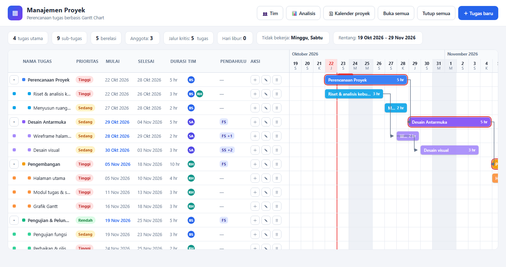
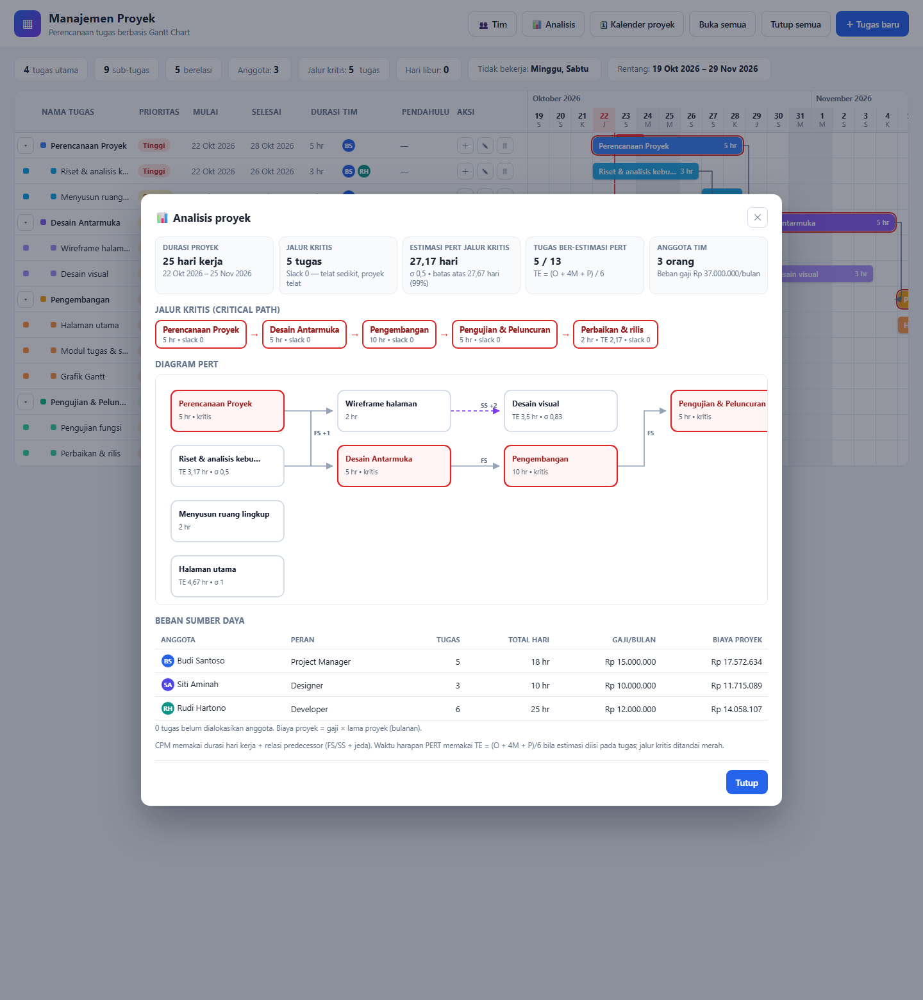

# Manajemen Proyek — Gantt Chart

Aplikasi perencanaan proyek berbasis **Gantt Chart** yang berjalan sepenuhnya di browser — tanpa server, tanpa instalasi. Cukup buka `index.html`.

## Fitur

- **Manajemen tugas (Tahap 1)** — CRUD tugas, sub-tugas bertingkat (expand/collapse), prioritas, warna indikator, dan Gantt Chart yang sinkron panel↔timeline.
- **Penjadwalan (Tahap 2)** — relasi *predecessor* **FS / SS** dengan jeda hari kerja, tanggal mulai terhitung otomatis, panah penghubung antar bar, serta **Kalender Proyek** (hari kerja khusus + daftar hari libur) yang menggeser seluruh jadwal.
- **Resource Management (Tahap 3)** — pendaftaran anggota tim (nama, email, peran, gaji) dan alokasi anggota ke tugas, lengkap dengan tabel beban sumber daya & estimasi biaya proyek.
- **Analisis Proyek (Tahap 3)** — **Critical Path (CPM)** berbasis hari kerja dengan penyorotan bar kritis di Gantt, **diagram PERT** (TE = (O + 4M + P)/6), dan statistik proyek.
- Data tersimpan otomatis di `localStorage` — aman saat browser ditutup.

## Tangkapan layar

### Gantt Chart



### Analisis Proyek — Critical Path & Diagram PERT



## Cara menjalankan

1. Clone repo ini, atau unduh ZIP lalu ekstrak.
2. Buka `index.html` di browser (Chrome, Firefox, Edge, Safari).
3. Semua fitur langsung tersedia; data contoh dimuat pada kunjungan pertama.

```bash
git clone https://github.com/ningsidaud512-cpu/project-tugas.git
cd project-tugas
# buka index.html di browser
```

## Struktur proyek

| File | Keterangan |
| --- | --- |
| `index.html` | Struktur halaman & modal (tugas, kalender, tim, analisis) |
| `style.css` | Seluruh gaya UI termasuk Gantt Chart dan modal |
| `script.js` | Logika aplikasi: CRUD, penjadwalan CPM/PERT, kalender, sumber daya |
| `assets/` | Screenshot UI untuk README |
| `chat-history.md` | Riwayat percakapan & perkembangan proyek |
